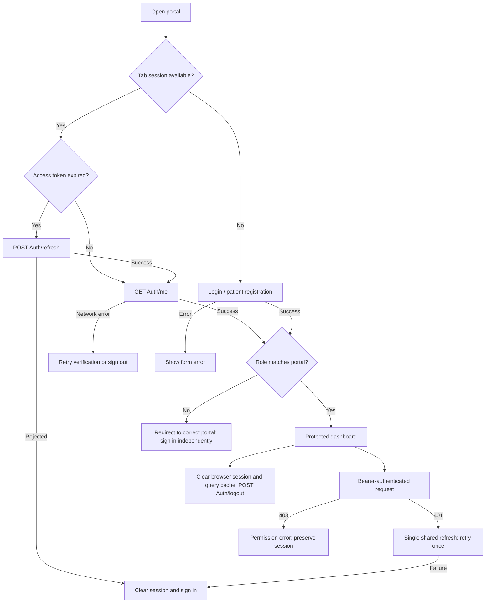

# FE Sprint 1 - Phase 2

Authentication is integrated independently in patient-web and staff-web. The existing
Material UI themes remain in use. Mock dashboards were removed; dashboards now show
only the authenticated account. Clinical API integration is outside this phase.
Backend code, database schema, and EF migrations were not changed.

## Backend contracts

Inspected AuthController, every DTO in DTOs/Auth, AuthService, TokenService,
UserRole, JwtSettings, Program, ExceptionHandlingMiddleware, controller routes,
launchSettings, and the non-secret JWT settings.

ASP.NET Core's default web JSON serialization uses camelCase:

| Method | Endpoint | Request | Response / access |
| --- | --- | --- | --- |
| POST | /api/Auth/login | LoginRequest | AuthResponse; anonymous |
| POST | /api/Auth/register | RegisterRequest | AuthResponse; anonymous, creates Patient only |
| POST | /api/Auth/refresh | RefreshTokenRequest | AuthResponse; rotates and revokes the old refresh token |
| POST | /api/Auth/logout | LogoutRequest | { message: string }; revokes the supplied refresh token |
| GET | /api/Auth/me | No body; Bearer header | CurrentUserResponse; authenticated |

Other discovered route families: /api/appointments, /api/Queue,
/api/patient-profiles, /api/doctors, /api/doctor-schedules, /api/departments,
and the SignalR /hubs/queue endpoint. These are not integrated into the UI here.
GET /api/Queue/doctor was used solely to verify Patient role rejection (403).

Roles are Patient, Doctor, Admin. RegisterRequest has no role field.
Email is required and normalized by the backend. Login requires a nonempty
password; registration requires at least 8 characters and matching confirmation.
Middleware errors have { statusCode: number, message: string }; model validation
uses ASP.NET Core validation problem details. JWT challenges may have no body.

JWT signing uses HMAC-SHA256, issuer/audience/signature/lifetime validation,
and zero clock skew. Development settings use issuer HIS.Api, audience HIS.Client,
30-minute access tokens, and 7-day refresh tokens. No signing key is copied to the frontend.

## TypeScript DTOs

Both apps export DTOs and runtime Zod response schemas from src/types/auth.ts.
The equivalent wire definitions are:

```ts
type UserRole = 'Patient' | 'Doctor' | 'Admin'
interface LoginRequest { email: string; password: string }
interface RegisterRequest extends LoginRequest { confirmPassword: string }
interface RefreshTokenRequest { refreshToken: string }
type LogoutRequest = RefreshTokenRequest
interface LogoutResponse { message: string }
interface CurrentUserResponse {
  userId: string // GUID
  email: string
  role: UserRole
}
interface AuthResponse extends CurrentUserResponse {
  accessToken: string
  refreshToken: string
  accessTokenExpiresAt: string // UTC ISO 8601
}
```

## Flow



Login/registration/logout use TanStack Query mutations. Password fields and mutation
state are reset after submission. Access tokens are attached by the authenticated
Axios client. Public auth calls use a separate client with no refresh interceptor.
Concurrent refresh requests share a promise. A retried request cannot refresh again.
A late refresh cannot restore credentials after logout or another login.

Patient accounts can enter only patient-web. Doctor/Admin accounts can enter only
staff-web. Wrong-portal sessions redirect to the configured other portal without
passing credentials or tokens in URLs. The other app requires its own sign-in.
Backend authorization remains the security boundary.

## Environment and running

Use each app's .env.example as the reference for an ignored .env.local.
All VITE_ variables are browser-visible and must never contain secrets.

| Variable | Application | Default / purpose |
| --- | --- | --- |
| VITE_API_BASE_URL | Both | /api; includes the API prefix |
| API_PROXY_TARGET | Both, development only | http://localhost:5216 |
| VITE_STAFF_PORTAL_URL | Patient | http://localhost:5174 |
| VITE_PATIENT_PORTAL_URL | Staff | http://localhost:5173 |

VITE_PORTAL is defined internally by each app's Vite config for storage isolation.
The backend's HTTP profile is on port 5216; its HTTPS profile is on 7017.
The HTTP endpoint was available during validation; HTTPS 7017 was unavailable.
Local HTTP is for development only; production must use HTTPS.

```powershell
# Separate terminals, from the repository root:
cd frontend/patient-web
npm run dev

cd frontend/staff-web
npm run dev
```

Default URLs: http://localhost:5173 and http://localhost:5174.
If Vite selects another port, update the other portal's URL environment variable.
Existing Staff Portal servers occupied 5174/5175. The verified server at 5174
serves the current staff source and API proxy; the duplicate server started for
verification was stopped. The Patient Portal server was started on 5173.

No backend CORS policy exists. Vite proxies /api in development.
Production requires a same-origin reverse proxy forwarding /api to the backend,
or explicitly approved backend CORS configuration when using a separate API origin.
The production host must also support SPA route fallback.

## Security and limitations

The backend exchanges tokens in JSON and requires the refresh token in request
bodies; it does not support HttpOnly refresh cookies. To restore authentication
after page refresh without changing the backend, this implementation keeps both
tokens in sessionStorage, separately per portal. Storage is tab-scoped and
closing the tab ends browser persistence. If storage is unavailable, only the
in-memory session remains and page refresh requires login again.

sessionStorage is readable by JavaScript, so XSS can steal tokens. The safer
follow-up is a backend-supported Secure, HttpOnly, SameSite refresh cookie with
appropriate CSRF protection, or a same-origin BFF, with access tokens held in
memory. That requires backend approval and was not implemented.
Reference: [OWASP Session Management](https://cheatsheetseries.owasp.org/cheatsheets/Session_Management_Cheat_Sheet.html).

Passwords are not persisted or logged. Tokens are never printed by the client or
test runner. The test runner suppresses raw Axios errors because their configs
can contain secrets. Query data is cleared on login/logout. Local logout succeeds
even if server revocation fails, with a warning on the sign-in page.

Backend logout revokes refresh tokens only. Already issued access JWTs remain
valid until expiry; clearing browser credentials does not revoke those JWTs.
Rotation is supported, but the inspected backend does not implement refresh-token
family reuse detection. Account-wide revocation and cookie support are future
backend concerns.

## Files

Created in BOTH apps (relative to each app root):

- .env.example
- src/types/auth.ts
- src/services/authSession.ts
- src/services/authApi.ts
- src/services/portal.ts
- src/hooks/useAuth.ts
- src/components/AuthBoundary.tsx
- src/components/AuthForm.tsx
- src/components/PortalMismatch.tsx
- src/layouts/AuthLayout.tsx
- src/pages/LoginPage.tsx

Patient-only addition: src/pages/RegisterPage.tsx.

Modified in BOTH apps:

- vite.config.ts
- src/main.tsx
- src/services/apiClient.ts
- src/routes/router.tsx
- src/layouts/AppLayout.tsx
- src/pages/PatientDashboard.tsx or src/pages/StaffDashboard.tsx

Removed from BOTH apps: src/services/mockDashboard.ts,
src/hooks/usePatientDashboard.ts or src/hooks/useStaffDashboard.ts,
src/types/dashboard.ts, src/components/StatCard.tsx.
The remaining form helpers are schemas only and do not fabricate API responses.

Repository-level additions: frontend/scripts/test-auth-live.mjs and this document.
No dependencies were added and no backend files were changed.
The existing worktree shows frontend as untracked, so git diff alone cannot
describe frontend changes against Phase 1.

## Validation

Final npm run lint and npm run build passed in both apps.
Build runs tsc -b with strict mode before Vite, so TypeScript checks also passed.
Vite builds required sandbox escalation due to a Windows spawn EPERM restriction.
The production bundles are about 747 kB (236 kB gzip), with a nonfatal >500 kB warning.

The live test runner loads the actual app's auth services and schemas; HTTP responses
come from the real backend. It uses an in-memory implementation of browser Storage
to exercise restoration under Node, not browser automation.

```powershell
# From the repository root; read-only auth failures and schema checks:
node frontend/scripts/test-auth-live.mjs patient-web
node frontend/scripts/test-auth-live.mjs staff-web

# Opt-in real registration/lifecycle checks. Creates one Patient record per run.
$env:AUTH_TEST_ALLOW_REGISTER = '1'
$env:AUTH_TEST_API_URL = 'http://localhost:5216/api'
node frontend/scripts/test-auth-live.mjs patient-web
node frontend/scripts/test-auth-live.mjs staff-web
Remove-Item Env:AUTH_TEST_ALLOW_REGISTER
Remove-Item Env:AUTH_TEST_API_URL
```

Live service checks passed for both apps: patient registration/login,
invalid credentials (401), unauthenticated /me (401), duplicate registration (400),
invalid DTOs (400), authenticated /me, storage restoration validated with /me,
Patient portal policy, Patient denial on Doctor queue (403), refresh rotation,
concurrent refresh deduplication, rejection of a reused refresh token,
automatic refresh after an actual 401, logout/revocation, and failed refresh
clearing the session without an infinite loop. Development proxies on ports
5173 and 5174 also returned the real backend 401 for unauthenticated /me.

Four disposable Patient accounts remain from the initial and final lifecycle runs.
All issued refresh tokens were revoked during cleanup. Passwords were generated
only in memory and not saved; no patient profiles or appointments were created.
The backend has no account deletion endpoint, so no cleanup database edits were made.
Remaining test account emails:

- fe-auth-test-1a58117d-9427-46df-bc6e-2cea16497643@example.invalid
- fe-auth-test-e9ca7f56-c828-4ecf-8d3a-55c928699b8b@example.invalid
- fe-auth-test-a48f9b14-e117-4d57-8cde-ff3997f5c345@example.invalid
- fe-auth-test-8afb5093-7202-4ea2-b069-0e1fb4c66d42@example.invalid

Browser automation was unavailable: the Browser skill reported no connected
browser. Visual/responsive checks, click-through login/logout, actual browser
refresh, and cross-portal redirect behavior were not verified end to end.
Successful Doctor/Admin login was not tested because no authorized staff test
credentials were provided. No success is claimed for those tests.

No auth DTO mismatch was found in the tested patient flow. Deployment CORS/proxy
requirements, JSON token storage, and logout's JWT expiry behavior are the material
integration limitations. No work beyond Phase 2 was implemented.
